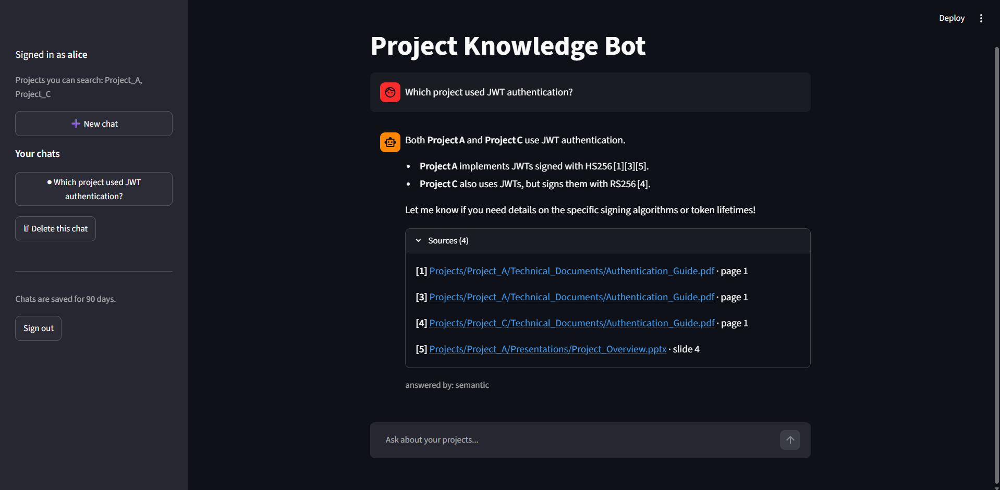
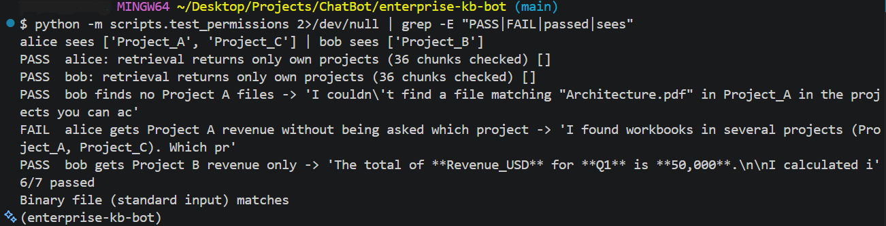

# Enterprise Project Knowledge Bot

Ask questions in plain English about company project files and get answers grounded in the real documents, with sources. Each person only gets answers from the projects they are allowed to see.



## What it does
- Searches PDFs, Word, Excel, PowerPoint, text, code and images (OCR for scans and photos).
- Answers with citations, and says "I couldn't find that" instead of guessing.
- Finds files by name and lets you download or preview them in chat.
- Calculates spreadsheet figures with pandas, so numbers are exact, not guessed by the AI.
- Saved chats per user, with resume, new chat and delete.

## How it works
```
Nextcloud (files, folders, users, permissions)  <- the source of truth
   |  WebDAV
   +--> sync_index --> extract text (+OCR) --> chunk --> embed (local MiniLM) --> Chroma
   |
Employee --> Streamlit chat (signs in with their Nextcloud account)
               --> LangGraph router --+-- semantic search --> permission re-check --> LLM --> answer + sources
                                      +-- file search -----> permission re-check --> download / preview
                                      +-- spreadsheet -----> pandas does the maths (the LLM only picks sheet and column)
                                      +-- small talk
```

## Security model
- **Two permission layers.** The index is filtered by the user's projects, then every hit is re-checked against Nextcloud as that user before any text reaches the LLM.
- **Project access is confirmed by Nextcloud file ID, not folder name**, so a user cannot create a folder called `Project_B` to gain access.
- **Files are downloaded as the signed-in user,** so Nextcloud decides again at that moment.
- Revoked access takes effect immediately, even for stale sessions and before the next sync.
- Saved chats are scoped by username in every query. Chats are deleted after 90 days.
- Guardrails: question length and a short blocklist, per-session rate limit, redaction of card numbers and key patterns in answers. These are cheap extras; the permission layers are the real protection.

## Setup
Prerequisites: Python 3.12, [uv](https://docs.astral.sh/uv/), Docker, Tesseract OCR, a free [Groq](https://console.groq.com) API key.

1. `git clone <repo> && cd <repo> && uv sync`
Activate the environment (Windows Git Bash: `source .venv/Scripts/activate`; macOS/Linux: `source .venv/bin/activate`), or put `uv run` in front of every `python` command below.
2. `cp .env.example .env` and fill in `GROQ_API_KEY` and `TESSERACT_CMD` (on Windows the UB Mannheim Tesseract build installs to `C:/Program Files/Tesseract-OCR/tesseract.exe`).
3. `docker compose up -d`, then open http://localhost:8080. If the installer appears, create an admin account and keep SQLite.
4. In Nextcloud, create accounts `kb_service`, `alice` and `bob`. Log in as each, then **Personal settings > Security > Create new app password**. Put `kb_service`'s into `.env` as `NEXTCLOUD_APP_PASSWORD`.
5. As `kb_service`, unzip `sample_data/Projects.zip` and upload the `Projects` folder (use **+ > Upload folder**).
6. Still as `kb_service`, share `Project_A` and `Project_C` with `alice`, and `Project_B` with `bob` (read only, no resharing).
7. Build the index: `python -m scripts.sync_index`
8. Start the app: `streamlit run app.py`, then sign in with a Nextcloud username and its app password.

To keep the index up to date: `python -m scripts.sync_index --watch 120`.

## Tests
- `pip install pytest` install pytest library 
- `python -m pytest -q` runs 20 unit tests with no server needed.
- `python -m scripts.eval_retrieval` checks that 9 questions find the right file.
- `python -m scripts.test_permissions` (needs `ALICE_APP_PASSWORD` and `BOB_APP_PASSWORD` in `.env`) checks that each user only gets their own projects' content.
- `python -m scripts.test_revocation` removes access mid-session and checks that nothing leaks.

## Results (31-file synthetic dataset)

| Check | Result |
|---|---|
| Files fully extracted | 30 of 31 (the last is an Excel chart, reported as unread) |
| Retrieval questions answered from the right file | 9 of 9 |
| Cross-user leak tests | 7 of 7 |
| Access revoked after indexing | no content returned |
| Typical answer time after start-up | about 2 seconds |

## Design decisions
| Decision | Why |
|---|---|
| Nextcloud stays the source of truth | The index is rebuildable, and permissions live in one place |
| Spreadsheet numbers computed by pandas | Embeddings are unreliable for exact figures |
| The LLM never writes code | It only fills in a validated plan: sheet, column, operation |
| Extraction returns a status per file | Unreadable content is reported, never silently dropped |
| Local embedding model | Documents are embedded on your machine |
| SQLite for chat history, Chroma for vectors | No extra servers for a project this size |
| Polling sync, not real time | Simple and testable. It states its delay honestly |

## Limitations
- Tested on a small synthetic dataset, not real company data.
- Sync is polling, so new files appear after the next run.
- Sign-in uses Nextcloud app passwords, not single sign-on.
- OCR can misread text, and the bot says so when it relies on it.
- Tables inside PDFs lose their row structure, and images inside documents are only read by OCR.
- No audit log of who asked what.
- The Groq free tier sends document text to a third party, so don't use it with confidential files.

## Roadmap
Dockerise the app, add a Vertex AI option, deploy to GCP, add SSO and an audit log.